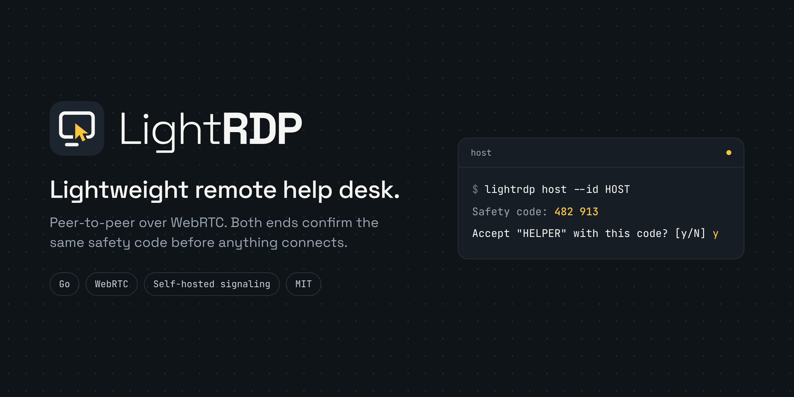

<p align="center">
  
</p>

> Current state: two machines can connect peer-to-peer (WebRTC) through a signaling server and exchange text messages. Remote desktop is not implemented yet.

## Quick start
Requires Go 1.26.9 or newer on each machine.

1. On the server machine, create a certificate with its IP address and start the server:
```
openssl req -x509 -newkey ec -pkeyopt ec_paramgen_curve:P-256 -nodes -days 365 \
  -keyout server.key -out server.crt -subj "/CN=LightRDP" \
  -addext "subjectAltName=IP:<SERVER_IP>"
go run ./cmd/lightrdp server --bind <SERVER_IP> --cert server.crt --key server.key
```
Copy `server.crt` to the other machines. `server.key` stays on the server.

2. On the host (the machine that will be accessed):
```
go run ./cmd/lightrdp host --id HOST --server wss://<SERVER_IP>:8080/ws --ca server.crt
```

3. On the other machine:
```
go run ./cmd/lightrdp join HOST --server wss://<SERVER_IP>:8080/ws --ca server.crt
```

4. Both machines show the same `Safety code: NNN NNN`. Compare it by phone or in person and answer `y` on both only if it matches. The chat then opens.

Every command has `--help`. To build the binary, run `go build ./cmd/lightrdp`. For all options, the network setup and what each prompt means, see [Getting Started](docs/app/getting_started.md).

## How it works
The signaling server (`lightrdp server`) registers clients by ID and relays the WebRTC negotiation over `wss://`; it never sees the peer-to-peer traffic. The host and the client then connect directly and chat over a DataChannel. The safety code comes from the DTLS certificates of that direct connection and from a random value chosen by each side, exchanged with a commit and reveal step before the code is shown. A swapped connection shows different codes on the two machines, and an attacker cannot search for certificates that make them match. See [Security](docs/app/security/README.md).

Built with Go, [pion/webrtc](https://github.com/pion/webrtc) and [coder/websocket](https://github.com/coder/websocket).

## Roadmap
- Access code: a short public ID tied to the machine plus a one-time password generated by the host.
- Remote desktop window for the client.

## Documentation
- [Application usage](docs/app/README.md)
- [Known errors](docs/errors/README.md)
- [Logo and visual assets](docs/assets/README.md)
- [Changelog](CHANGELOG.md)
